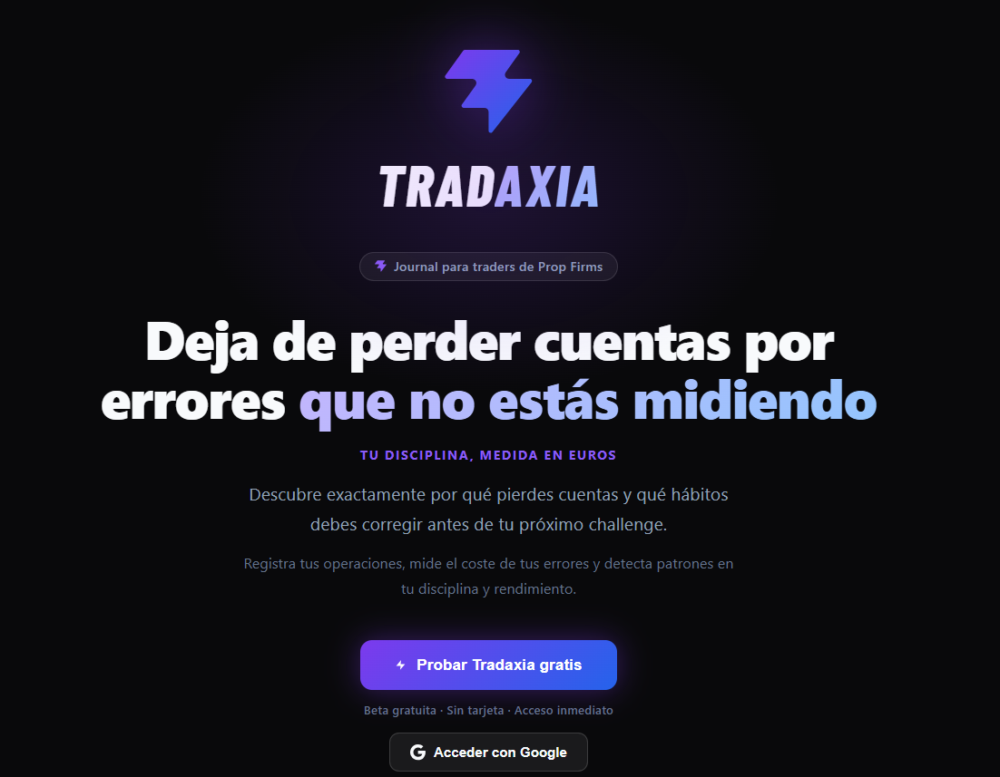
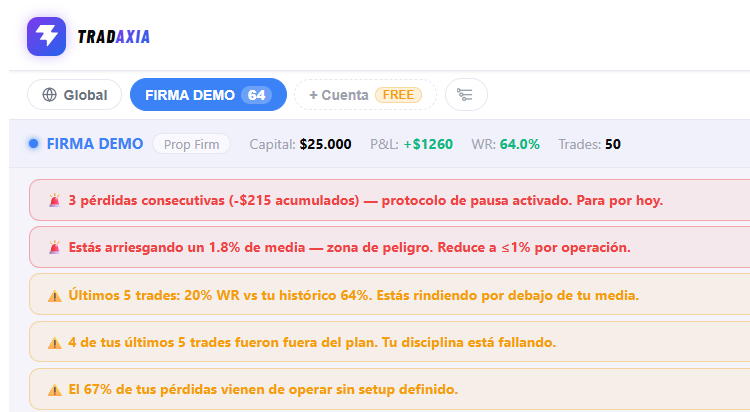
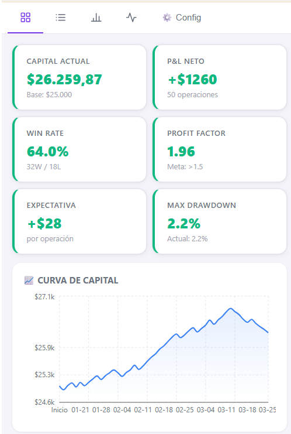
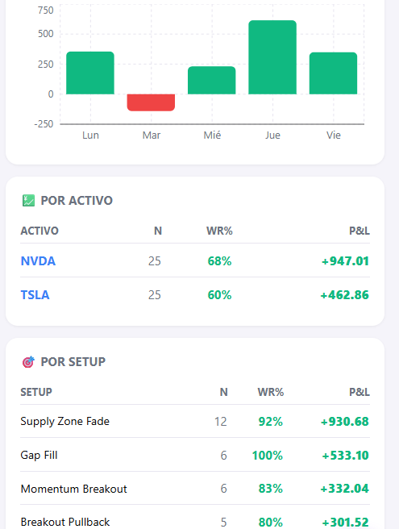
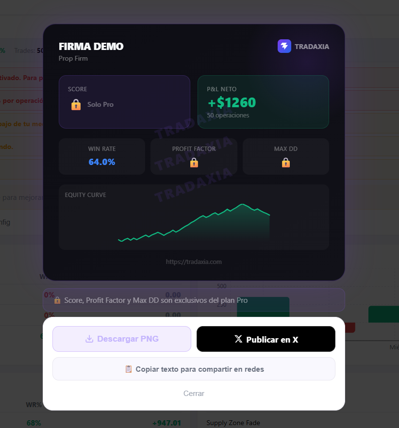
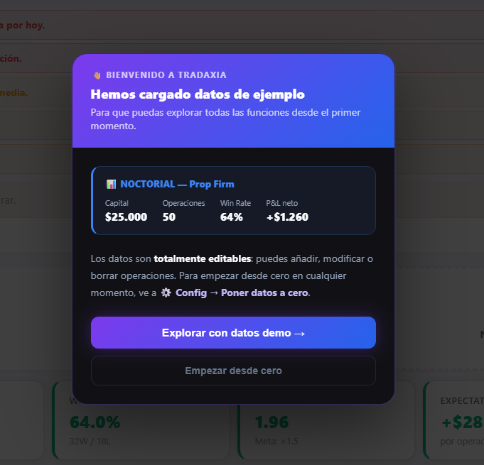

# TRADAXIA · Caso de estudio

**Diario de trading para traders de prop firms, construido de principio a fin con IA.**

🔗 **Producto en producción:** [tradaxia.com](https://tradaxia.com)
🔒 El código es privado. Este repositorio cuenta qué es, cómo está hecho y cómo lo construí.

  

---

## El problema

Los traders de prop firms (FTMO, The5%ers, E8…) repiten los mismos errores porque no tienen datos que los hagan visibles. Un Excel de operaciones no les dice cuánto les cuesta saltarse el plan, ni en qué sesión o con qué activo pierden.

## La solución

TRADAXIA no es solo un diario de operaciones: es un sistema de mejora basado en métricas.

- **Score del trader (0-100):** disciplina, riesgo, consistencia y errores en una sola cifra.
- **Coste de la indisciplina:** cuánto dinero ha costado cada tipo de error.
- **Alertas automáticas:** 3 pérdidas seguidas, riesgo por encima del 1,5 %, caída del % de acierto, operar sin plan o sin setup.
- **Analítica:** resultados por sesión, día, activo y setup; comparativa entre cuentas.
- **Multicuenta:** varias prop firms desde una sola vista.
- **Tarjeta para compartir** resultados, y exportación a CSV y JSON.

  

  
  

  

Pensado para el trader manual que no puede o no quiere conectar su bróker por API, y centrado en el patrón emocional detrás de las pérdidas.

## Cómo está hecho

| Capa | Tecnología |
|---|---|
| Frontend | React 18 + Vite |
| Gráficos | Recharts |
| Autenticación | Supabase Auth + Google OAuth |
| Base de datos | Supabase (PostgreSQL con seguridad por filas) |
| Funciones de servidor | Supabase Edge Functions (Deno) |
| Email | Resend |
| Despliegue | Vercel, con despliegue automático en cada cambio |

Incluye landing con lista de espera, onboarding, datos de demostración para usuarios nuevos y un modelo de planes gratuito/Pro.

  

## Cómo lo construí: con IA

No vengo del desarrollo de software: vengo del negocio y la consultoría TI. TRADAXIA nació porque, operando yo mismo, el Excel no me aportaba nada. La construí con **Claude** (Anthropic) como asistente de programación, después de empezar con Gemini y ChatGPT.

Cómo trabajo con la IA:

- **Reglas de trabajo explícitas** para el asistente: pensar antes de programar, preguntar ante la duda, código mínimo y cambios precisos.
- **Documentación viva** que la IA lee al empezar cada sesión: contexto del producto, arquitectura, tareas pendientes y una bitácora de sesiones con las decisiones tomadas.
- **Auditoría del propio proyecto** con la IA para detectar riesgos técnicos y de negocio.
- **Yo decido; la IA ejecuta y propone.** El producto, las prioridades y la validación con usuarios son míos.

El resultado: un producto completo en producción (autenticación, base de datos, emails, planes Free/Pro, landing) llevado por una sola persona.

## Estado

En producción y en fase de validación con traders reales. La prioridad es confirmar que resuelve un problema antes de crecer.

---

**William Segovia** · [LinkedIn](https://www.linkedin.com/in/william-segovia) · [tradaxia.com](https://tradaxia.com)
